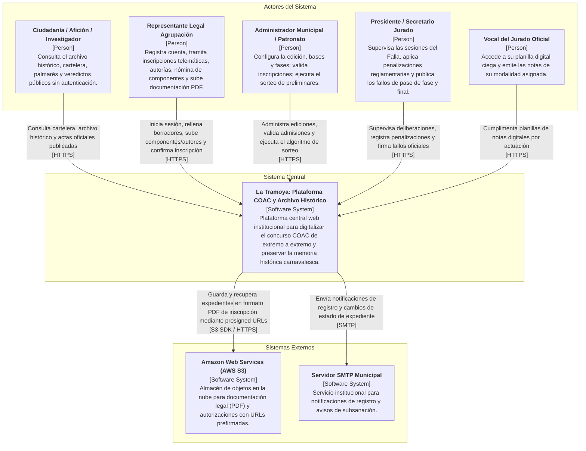
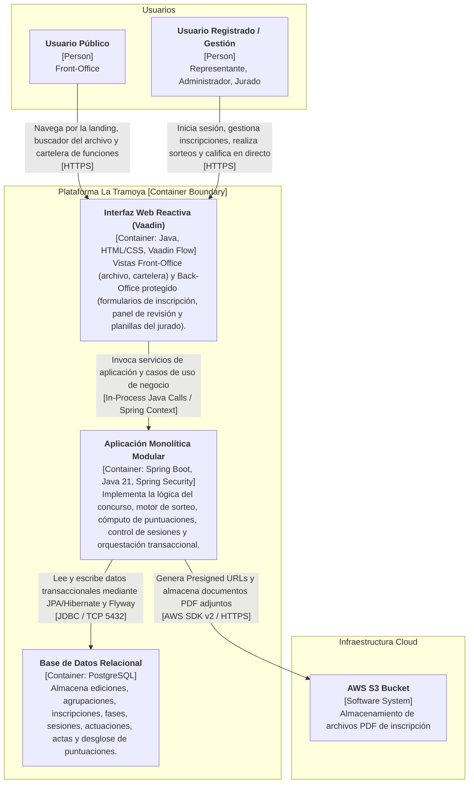
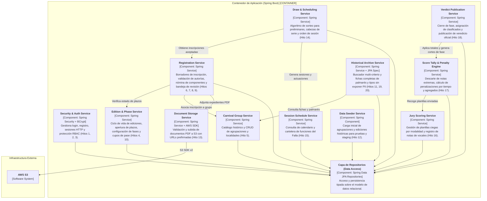

# Arquitectura del Sistema - Modelo C4 (La Tramoya)

Este documento describe la arquitectura global del sistema **La Tramoya (Plataforma COAC y Archivo Histórico)** siguiendo la metodología C4 (Contexto, Contenedores y Componentes) que cubre los hitos funcionales 1 al 20.

---

## 1. C4 Nivel 1: Diagrama de Contexto del Sistema

Describe la interacción entre los distintos tipos de usuarios institucionales y de la ciudadanía con el sistema La Tramoya y los sistemas externos integrados.

---

## 2. C4 Nivel 2: Diagrama de Contenedores

Muestra la separación física y de procesos: la capa de presentación rica e interactiva en **Vaadin Flow**, el monolito modular desacoplado en **Spring Boot**, la base de datos relacional **PostgreSQL** y el almacenamiento de expedientes en **AWS S3**.

---

## 3. C4 Nivel 3: Diagrama de Componentes del Backend (Hitos 1 al 20)

Detalla los componentes modulares de Spring Boot y el flujo de comunicación interna y de dependencias hacia la capa de persistencia y servicios externos.

---

## 4. Trazabilidad por Hitos de Desarrollo (Hitos 1 al 20)

| Hito | Área Funcional | Componente Backend Responsable |
| :--- | :--- | :--- |
| **Hito 1** | Autenticación y Cuentas | `Security & Auth Service` |
| **Hito 2** | Gestión de Roles y Permisos (RBAC) | `Security & Auth Service` |
| **Hito 3** | Perfil de Usuario y Sesión | `Security & Auth Service` |
| **Hito 4** | Configuración de Edición COAC | `Edition & Phase Service` |
| **Hito 5** | Catálogo de Agrupaciones y Localidades | `Carnival Group Service` |
| **Hito 6** | Borrador de Inscripción Telemática | `Registration Service` |
| **Hito 7** | Registro de Autorías y Representantes | `Registration Service` |
| **Hito 8** | Registro de Nómina de Componentes | `Registration Service` |
| **Hito 9** | Bandeja Municipal de Revisión y Admisión | `Registration Service` |
| **Hito 10** | Configuración de Fases y Cupos de Pase | `Edition & Phase Service` |
| **Hito 11** | Consulta Pública de Agrupaciones Inscritas | `Historical Archive Service` |
| **Hito 12** | Carga de Datos Históricos (Data Seeding) | `Data Seeder Service` |
| **Hito 13** | Almacenamiento Seguro de Expedientes PDF | `Document Storage Service` (AWS S3) |
| **Hito 14** | Motor de Sorteo y Orden de Preliminares | `Draw & Scheduling Service` |
| **Hito 15** | Cartelera y Calendario del Falla | `Session Schedule Service` |
| **Hito 16** | Planilla Digital de Puntuaciones Ciegas | `Jury Scoring Service` |
| **Hito 17** | Motor de Cómputo de Medias y Penalizaciones | `Score Tally & Penalty Engine` |
| **Hito 18** | Cierre de Fases, Clasificados y Fallo Oficial | `Verdict Publication Service` |
| **Hito 19** | Buscador Avanzado del Archivo Histórico | `Historical Archive Service` |
| **Hito 20** | Fichas de Agrupaciones, Palmarés y Tipos (GDPR) | `Historical Archive Service` |
