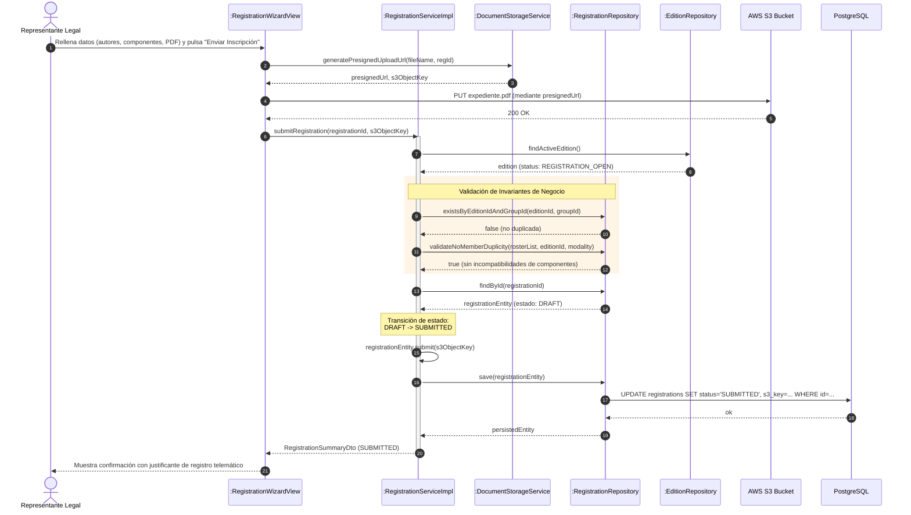
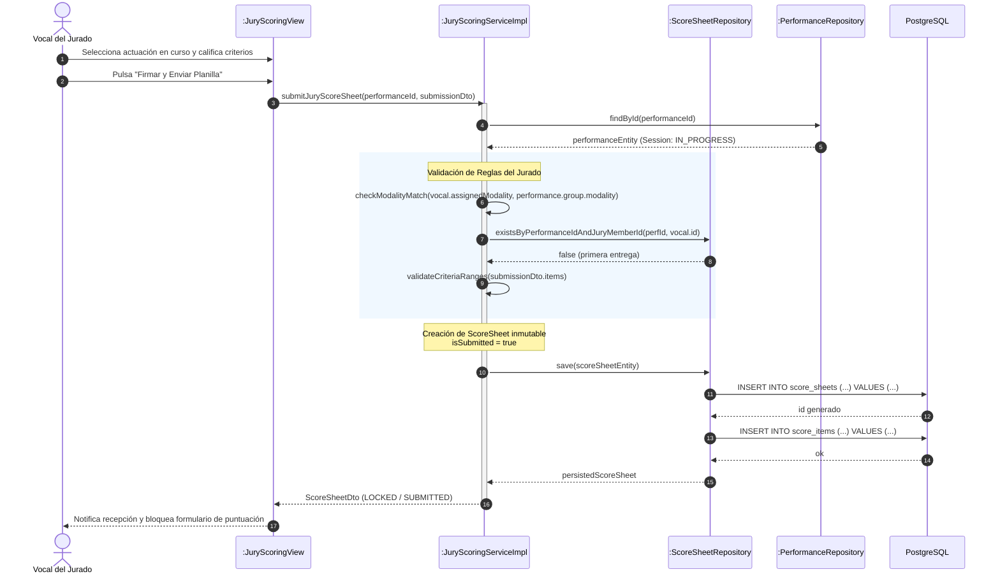
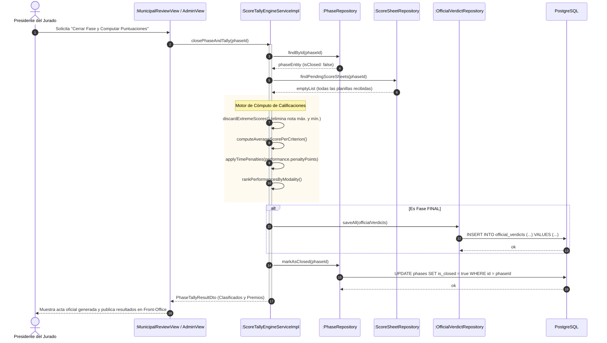

# Diagramas de Secuencia del Sistema

Este documento recoge los diagramas de secuencia detallados en sintaxis **Mermaid** para los flujos de interacción clave del sistema **La Tramoya**, cubriendo la interacción entre la interfaz Vaadin, los servicios de aplicación `@Transactional`, los repositorios Spring Data JPA, entidades del dominio y los servicios de infraestructura externa (AWS S3 y PostgreSQL).

---

## 1. Tramitación Telemática de Inscripción (Representante Legal)

Refleja el flujo completo donde el representante legal de una agrupación rellena los datos, sube el archivo PDF mediante una URL prefirmada de AWS S3, y formaliza el envío ejecutando las validaciones de invariantes de negocio (no duplicidad de grupo en la edición, no incompatibilidad de componentes en la misma modalidad y transición de estado).

---

## 2. Emisión y Firma de Planilla Confidencial de Puntuación (Vocal del Jurado)

Describe el proceso en vivo en el Gran Teatro Falla cuando un vocal del jurado evalúa a una agrupación de su modalidad asignada, calculando el subtotal y bloqueando la planilla de forma inmutable.

---

## 3. Cierre de Fase, Cómputo de Medias y Fallo Oficial (Presidente del Jurado)

Flujo de agregación de calificaciones al terminar una fase del COAC, con aplicación de penalizaciones de tiempo y descarte de notas extremas.

