# Modelo Lógico de Datos (Relacional - PostgreSQL)

Este documento define la estructura lógica relacional de la base de datos para la plataforma **La Tramoya**, optimizada para PostgreSQL 16 y alineada con los Hitos 1 al 20.

---

## 1. Diagrama Entidad-Relación (Mermaid erDiagram)

```mermaid
erDiagram
    PERSONS ||--o{ REGISTRATIONS : "representa legalmente"
    PERSONS ||--o{ AUTHORSHIPS : "crea letra/musica"
    PERSONS ||--o{ ROSTER_MEMBERS : "forma parte de"
    PERSONS ||--o{ JURY_MEMBERS : "actua como juez"

    CARNIVAL_GROUPS ||--o{ REGISTRATIONS : "inscribe historial"

    EDITIONS ||--o{ PHASES : "se compone de"
    EDITIONS ||--o{ REGISTRATIONS : "contiene inscripciones"
    EDITIONS ||--o{ JURY_MEMBERS : "asigna vocales"
    EDITIONS ||--o{ OFFICIAL_VERDICTS : "emite palmares"

    REGISTRATIONS ||--o{ AUTHORSHIPS : "acredita autores"
    REGISTRATIONS ||--o{ ROSTER_MEMBERS : "acredita componentes"
    REGISTRATIONS ||--o{ PERFORMANCES : "sube a las tablas"
    REGISTRATIONS ||--o{ OFFICIAL_VERDICTS : "obtiene calificacion"

    PHASES ||--o{ SESSIONS : "organiza en dias"
    SESSIONS ||--o{ PERFORMANCES : "incluye actuaciones"

    PERFORMANCES ||--o{ SCORE_SHEETS : "recibe calificaciones"
    JURY_MEMBERS ||--o{ SCORE_SHEETS : "cumplimenta planilla"
    SCORE_SHEETS ||--o{ SCORE_ITEMS : "desglosa por criterio"

    PERSONS {
        bigint id PK "Clave primaria autoincremental"
        varchar national_id UK "DNI / NIE unico"
        varchar first_name "Nombre de pila"
        varchar last_name "Apellidos"
        varchar email UK "Correo electronico de acceso"
        varchar password_hash "Contrasena cifrada con BCrypt"
        varchar phone "Telefono de contacto"
        varchar role "Rol canonico RBAC (MUNICIPAL_ADMIN, etc.)"
        timestamp created_at "Fecha y hora de registro"
    }

    CARNIVAL_GROUPS {
        bigint id PK "Clave primaria autoincremental"
        varchar official_name UK "Nombre canonico del grupo carnavalesco"
        varchar modality "CORO, COMPARSA, CHIRIGOTA, CUARTETO"
        varchar locality "Municipio de origen (Cadiz u otras)"
        varchar province "Provincia de origen"
        text historical_notes "Resena historica y fundacional"
    }

    EDITIONS {
        bigint id PK "Clave primaria autoincremental"
        integer year UK "Ano fiscal del concurso (ej. 2026)"
        varchar name "Nombre oficial (ej. COAC 2026)"
        varchar status "DRAFT, REGISTRATION_OPEN, DRAW_COMPLETED, IN_COMPETITION, FINISHED_SEALED"
        date reg_start_date "Fecha inicio admision de solicitudes"
        date reg_end_date "Fecha fin admision de solicitudes"
        boolean is_sealed "Inmutabilidad archivistica"
    }

    REGISTRATIONS {
        bigint id PK "Clave primaria autoincremental"
        bigint edition_id FK "Edicion a la que postula"
        bigint group_id FK "Agrupacion participante"
        bigint legal_rep_id FK "Representante legal que tramita"
        varchar costume_theme "Nombre del Tipo / Disfraz anual"
        varchar status "DRAFT, SUBMITTED, UNDER_REVIEW, ACCEPTED, REJECTED, WITHDRAWN"
        timestamp submission_date "Fecha y hora de envio telematico"
        varchar s3_document_key "Ruta del PDF de autorizaciones en AWS S3"
        text municipal_notes "Comentarios o peticiones de subsanacion"
    }

    AUTHORSHIPS {
        bigint id PK "Clave primaria autoincremental"
        bigint registration_id FK "Expediente de inscripcion"
        bigint person_id FK "Persona fisica acreditada"
        varchar role "LYRICS, MUSIC, DIRECTOR, LEGAL_REPRESENTATIVE"
    }

    ROSTER_MEMBERS {
        bigint id PK "Clave primaria autoincremental"
        bigint registration_id FK "Expediente de inscripcion"
        bigint person_id FK "Persona fisica acreditada"
        varchar role "SINGER, MUSICIAN, EXTRA"
        integer voice_number "Identificador de cuerda/voz"
        boolean is_substitute "Indica si es componente suplente"
    }

    PHASES {
        bigint id PK "Clave primaria autoincremental"
        bigint edition_id FK "Edicion correspondiente"
        varchar phase_type "PRELIMINARES, CUARTOS_DE_FINAL, SEMIFINALES, FINAL"
        integer order_index "Secuencia cronologica de la fase (1 a 4)"
        integer max_advancing_groups "Cupo maximo de corte clasificatorio"
        boolean scores_carry_over "Define si las notas se arrastran o resetean"
        boolean is_closed "Bloqueo de fase tras publicacion de fallos"
    }

    SESSIONS {
        bigint id PK "Clave primaria autoincremental"
        bigint phase_id FK "Fase a la que pertenece la sesion"
        varchar session_code UK "Identificador de sesion (ej. PRE-01)"
        timestamp session_date "Fecha y hora de celebracion en el Falla"
        varchar status "SCHEDULED, IN_PROGRESS, COMPLETED, CANCELLED"
    }

    PERFORMANCES {
        bigint id PK "Clave primaria autoincremental"
        bigint session_id FK "Sesion programada en el Falla"
        bigint registration_id FK "Inscripcion participante"
        integer order_in_session "Numero de orden de actuacion en la noche"
        varchar status "PENDING, ON_STAGE, FINISHED, DISQUALIFIED"
        time stage_time_start "Hora real de apertura de cortinas"
        time stage_time_end "Hora real de caida de cortinas"
        numeric penalty_points "Puntos deducidos por exceso de tiempo"
    }

    JURY_MEMBERS {
        bigint id PK "Clave primaria autoincremental"
        bigint edition_id FK "Edicion del concurso"
        bigint person_id FK "Persona fisica del jurado"
        varchar assigned_modality "Modalidad asignada (CORO, COMPARSA, etc.)"
        boolean is_president "Distingue Presidente/Secretario de Vocal"
    }

    SCORE_SHEETS {
        bigint id PK "Clave primaria autoincremental"
        bigint performance_id FK "Actuacion calificada"
        bigint jury_member_id FK "Vocal que emite el acta ciega"
        numeric total_score "Suma total de puntos asignados"
        boolean is_submitted "Indica si el acta ha sido firmada y cerrada"
        timestamp submitted_at "Fecha y hora de emision de la planilla"
    }

    SCORE_ITEMS {
        bigint id PK "Clave primaria autoincremental"
        bigint score_sheet_id FK "Planilla a la que pertenece el item"
        varchar criterion "PRESENTACION, PASODOBLE_TANGO, CUPLE, POPURRI, TIPO"
        numeric raw_points "Calificacion concedida en el criterio"
    }

    OFFICIAL_VERDICTS {
        bigint id PK "Clave primaria autoincremental"
        bigint edition_id FK "Edicion oficial"
        bigint registration_id FK "Agrupacion receptora"
        varchar award_category "FIRST_PRIZE, SECOND_PRIZE, FIRST_ACCESIT, etc."
        numeric final_score "Puntuacion consolidada definitiva"
        integer rank_position "Posicion oficial de clasificacion"
    }
```

---

## 2. Diccionario de Tablas Lógicas y Restricciones de Integridad

### 1. `persons`
Tabla central para todos los individuos del ecosistema (usuarios, directores, autores, componentes, vocales).
- `id`: BIGSERIAL PRIMARY KEY
- `national_id`: VARCHAR(20) NOT NULL UNIQUE (DNI/NIE)
- `first_name`: VARCHAR(100) NOT NULL
- `last_name`: VARCHAR(100) NOT NULL
- `email`: VARCHAR(150) NOT NULL UNIQUE
- `password_hash`: VARCHAR(255) NOT NULL
- `phone`: VARCHAR(25)
- `role`: VARCHAR(50) NOT NULL
- `created_at`: TIMESTAMP NOT NULL DEFAULT CURRENT_TIMESTAMP

### 2. `carnival_groups`
Agrupación carnavalesca como entidad histórica permanente en el tiempo.
- `id`: BIGSERIAL PRIMARY KEY
- `official_name`: VARCHAR(150) NOT NULL UNIQUE
- `modality`: VARCHAR(30) NOT NULL (CORO, COMPARSA, CHIRIGOTA, CUARTETO)
- `locality`: VARCHAR(100) NOT NULL
- `province`: VARCHAR(100) NOT NULL
- `historical_notes`: TEXT

### 3. `editions`
Edición anual del COAC con ciclo de vida.
- `id`: BIGSERIAL PRIMARY KEY
- `year`: INTEGER NOT NULL UNIQUE
- `name`: VARCHAR(100) NOT NULL
- `status`: VARCHAR(40) NOT NULL DEFAULT 'DRAFT'
- `reg_start_date`: DATE NOT NULL
- `reg_end_date`: DATE NOT NULL
- `is_sealed`: BOOLEAN NOT NULL DEFAULT FALSE

### 4. `registrations`
Inscripción formal de un grupo a un año de concurso concreto con su *tipo*.
- `id`: BIGSERIAL PRIMARY KEY
- `edition_id`: BIGINT NOT NULL REFERENCES editions(id) ON DELETE RESTRICT
- `group_id`: BIGINT NOT NULL REFERENCES carnival_groups(id) ON DELETE RESTRICT
- `legal_rep_id`: BIGINT NOT NULL REFERENCES persons(id) ON DELETE RESTRICT
- `costume_theme`: VARCHAR(150) NOT NULL
- `status`: VARCHAR(30) NOT NULL DEFAULT 'DRAFT'
- `submission_date`: TIMESTAMP
- `s3_document_key`: VARCHAR(255)
- `municipal_notes`: TEXT
- **Restricción de unicidad:** `UNIQUE (edition_id, group_id)`

### 5. `authorships`
Acreditación oficial de la autoría de letra, música o dirección.
- `id`: BIGSERIAL PRIMARY KEY
- `registration_id`: BIGINT NOT NULL REFERENCES registrations(id) ON DELETE CASCADE
- `person_id`: BIGINT NOT NULL REFERENCES persons(id) ON DELETE RESTRICT
- `role`: VARCHAR(40) NOT NULL

### 6. `roster_members`
Componentes de la nómina oficial presentada ante el Patronato.
- `id`: BIGSERIAL PRIMARY KEY
- `registration_id`: BIGINT NOT NULL REFERENCES registrations(id) ON DELETE CASCADE
- `person_id`: BIGINT NOT NULL REFERENCES persons(id) ON DELETE RESTRICT
- `role`: VARCHAR(40) NOT NULL
- `voice_number`: INTEGER
- `is_substitute`: BOOLEAN NOT NULL DEFAULT FALSE

### 7. `phases`
Fases clasificatorias del concurso.
- `id`: BIGSERIAL PRIMARY KEY
- `edition_id`: BIGINT NOT NULL REFERENCES editions(id) ON DELETE CASCADE
- `phase_type`: VARCHAR(40) NOT NULL
- `order_index`: INTEGER NOT NULL
- `max_advancing_groups`: INTEGER NOT NULL
- `scores_carry_over`: BOOLEAN NOT NULL DEFAULT TRUE
- `is_closed`: BOOLEAN NOT NULL DEFAULT FALSE

### 8. `sessions`
Funciones nocturnas en el Gran Teatro Falla.
- `id`: BIGSERIAL PRIMARY KEY
- `phase_id`: BIGINT NOT NULL REFERENCES phases(id) ON DELETE CASCADE
- `session_code`: VARCHAR(20) NOT NULL UNIQUE
- `session_date`: TIMESTAMP NOT NULL
- `status`: VARCHAR(30) NOT NULL DEFAULT 'SCHEDULED'

### 9. `performances`
Pase de una agrupación en una sesión específica.
- `id`: BIGSERIAL PRIMARY KEY
- `session_id`: BIGINT NOT NULL REFERENCES sessions(id) ON DELETE CASCADE
- `registration_id`: BIGINT NOT NULL REFERENCES registrations(id) ON DELETE RESTRICT
- `order_in_session`: INTEGER NOT NULL
- `status`: VARCHAR(30) NOT NULL DEFAULT 'PENDING'
- `stage_time_start`: TIME
- `stage_time_end`: TIME
- `penalty_points`: NUMERIC(5,2) NOT NULL DEFAULT 0.00
- **Restricción de unicidad:** `UNIQUE (session_id, order_in_session)`

### 10. `jury_members`
Composición del Jurado Oficial del COAC por edición.
- `id`: BIGSERIAL PRIMARY KEY
- `edition_id`: BIGINT NOT NULL REFERENCES editions(id) ON DELETE CASCADE
- `person_id`: BIGINT NOT NULL REFERENCES persons(id) ON DELETE RESTRICT
- `assigned_modality`: VARCHAR(30) NOT NULL
- `is_president`: BOOLEAN NOT NULL DEFAULT FALSE

### 11. `score_sheets`
Acta digital emitida por un vocal para una actuación concreta.
- `id`: BIGSERIAL PRIMARY KEY
- `performance_id`: BIGINT NOT NULL REFERENCES performances(id) ON DELETE RESTRICT
- `jury_member_id`: BIGINT NOT NULL REFERENCES jury_members(id) ON DELETE RESTRICT
- `total_score`: NUMERIC(6,2) NOT NULL DEFAULT 0.00
- `is_submitted`: BOOLEAN NOT NULL DEFAULT FALSE
- `submitted_at`: TIMESTAMP
- **Restricción de unicidad (voto único ciego):** `UNIQUE (performance_id, jury_member_id)`

### 12. `score_items`
Desglose de notas por criterio reglamentario.
- `id`: BIGSERIAL PRIMARY KEY
- `score_sheet_id`: BIGINT NOT NULL REFERENCES score_sheets(id) ON DELETE CASCADE
- `criterion`: VARCHAR(50) NOT NULL
- `raw_points`: NUMERIC(5,2) NOT NULL

### 13. `official_verdicts`
Premios oficiales y fallos históricos del COAC.
- `id`: BIGSERIAL PRIMARY KEY
- `edition_id`: BIGINT NOT NULL REFERENCES editions(id) ON DELETE RESTRICT
- `registration_id`: BIGINT NOT NULL REFERENCES registrations(id) ON DELETE RESTRICT
- `award_category`: VARCHAR(50) NOT NULL
- `final_score`: NUMERIC(7,2) NOT NULL
- `rank_position`: INTEGER NOT NULL
